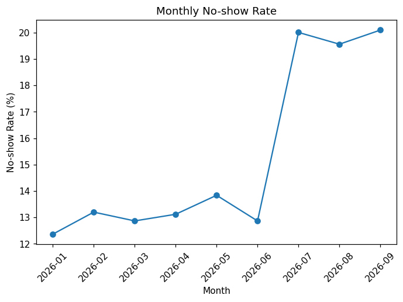
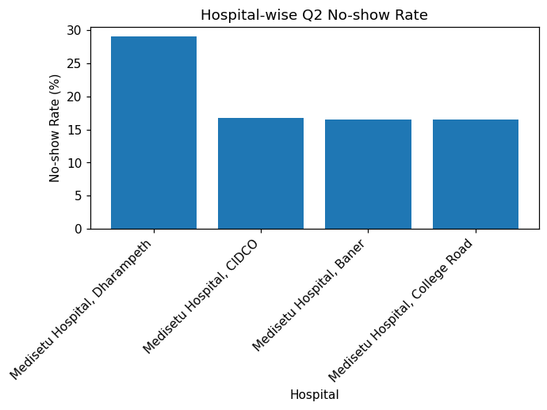
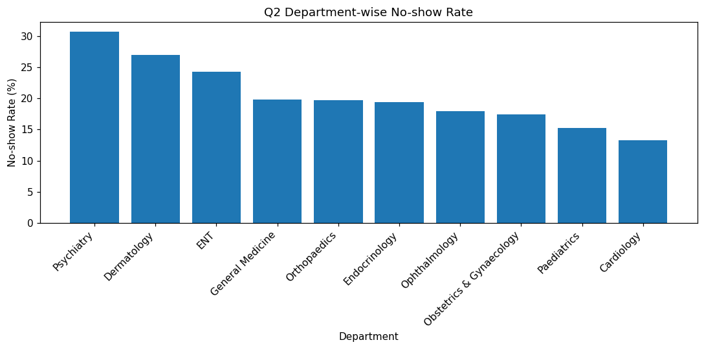

# OPD Appointment No-Show Spike

**Healthcare** · SQL, Python (pandas, seaborn)

Patients are missing far more outpatient appointments since July. Find out where and why — SMS reminders, the new booking app, departments or patients — and how much revenue it is costing.

> A live industry project on [JobPrax](https://www.jobprax.com). The client, Medisetu Hospitals Pvt Ltd, and its data are simulated.
> Certificate: [https://www.jobprax.com/certificates/DD-73YM-93A9](https://www.jobprax.com/certificates/DD-73YM-93A9)

## Business problem

Management does not know how much the no-show rate has risen, which hospitals, departments and booking channels are affected, or why. Possible causes raised in the leadership meeting include the new patient app, problems with SMS reminders, and particular departments or patient groups. The Chief Operating Officer needs a clear, data-backed analysis of appointments from 2 January to 30 September 2026 to decide what to fix first.

## Objectives

- Clean the appointment data and calculate the no-show rate for Q1 (April–June) and Q2 (July–September) 2026.
- Find which hospitals, departments, booking channels, payment modes and patient groups have the highest no-show rates.
- Check whether SMS reminders reached patients and how much they reduce no-shows.
- Measure the effect of booking lead time and of the new patient app.
- Estimate the consultation revenue lost to no-shows and recommend practical actions.

## Executive summary

# COO Report: Hospital Appointment No-Show Analysis

## Executive answer

Appointment no-shows are an operational and revenue concern. They result in unused appointment capacity and potential loss of consultation revenue. The analysis should focus on identifying where no-shows are highest, which patient and booking patterns are associated with them, and whether delivered reminders help reduce missed appointments.

## 1. Size of the problem

- **Appointments received:** 57,495
- **Exact duplicate rows identified:** 140
- **Raw no-show records:** 8,459
- **Raw completed records:** 45,832
- **Raw cancelled records:** 3,204
- **Pre-cleaning no-show rate:** 15.58% (no-shows divided by completed plus no-shows)

*Note: These status figures are from the original extract before duplicate removal. They are baseline figures, not the final cleaned or Q2 results.*

## 2. Main drivers to investigate

The analysis examines the following operational factors:

- **Hospital and department:** Identify locations and departments with the highest no-show rates, applying the minimum appointment threshold.
- **Patient age:** Compare no-show rates across age bands, excluding patients with missing age.
- **Visit type:** Compare new and follow-up appointments.
- **Booking behaviour:** Examine booking channels and how far ahead patients book.
- **Reminders:** Compare no-show rates for appointments with delivered and non-delivered reminders.
- **Revenue impact:** Identify doctors with the highest estimated lost consultation revenue from no-show appointments.
- **Quarterly movement:** Compare Q1 and Q2 hospital-wise no-show rates to identify the largest increases.

## 3. Top recommendation

Introduce a targeted appointment-confirmation and reminder process rather than applying the same intervention across every hospital.

Prioritise hospitals and departments with the highest eligible no-show rates. Focus reminder follow-ups on appointments booked in advance, monitor delivery success, and review no-show trends monthly. Track the impact using the no-show rate, reminder delivery percentage and estimated lost revenue.

## Conclusion

The priority is to reduce avoidable missed appointments, recover unused appointment capacity and improve revenue utilisation. Management should use the hospital-wise and patient-segment results to direct interventions where they can have the greatest operational impact.

## Key findings

## Key Findings – What the Data Revealed

The analysis shows that appointment no-shows are a significant operational issue. Out of 57,495 appointment records, 8,459 were recorded as no-shows. This represents a **15.58% no-show rate**, calculated using completed and no-show appointments only. This means approximately 1 in every 6.4 valid appointments was missed.

### 1. Overall appointment performance

The Appointment Status Distribution chart highlights the scale of missed appointments:

- Total appointments: **57,495**
- Completed appointments: **45,832**
- No-show appointments: **8,459**
- Cancelled appointments: **3,204**
- Overall no-show rate: **15.58%**

The number of missed appointments indicates an opportunity to improve appointment attendance and make better use of available hospital capacity.

### 2. Data quality findings

The data quality review identified **140 exact duplicate records**. Appointment statuses also appeared in different formats, such as `Completed`, `COMPLETED`, `No-show`, `No Show` and `noshow`.

These variations were standardised before calculating performance metrics. This ensured that the same appointment status was not counted as multiple categories.

### 3. Hospital and department performance

The Hospital-wise No-show Rate and Department-wise No-show Rate charts are used to identify where missed appointments are concentrated. These comparisons help management identify hospitals and departments that may require additional attention.

The department comparison also considers only departments with at least 100 completed and no-show appointments, making the comparison more meaningful.

### 4. Patient and booking behaviour

The Age Band, Visit Type and Booking Channel analyses examine whether missed appointments vary across patient groups and booking patterns.

The lead-time analysis also helps management understand how far in advance patients book their appointments. These findings can help identify which groups may benefit from additional appointment confirmations or reminders.

### 5. Reminder effectiveness and revenue impact

The Reminder Effectiveness analysis compares no-show rates between appointments with delivered and non-delivered reminders. The analysis also examines appointments booked 1–14 days ahead with delivered reminders to assess a potentially controllable segment of missed appointments.

The Doctor-wise Lost Revenue chart identifies doctors with the highest estimated revenue loss from no-show appointments, helping management understand the financial impact.

### 6. Quarterly performance

The Q1 versus Q2 Hospital Performance chart compares hospital-wise no-show rates and highlights changes in percentage points. This helps the COO identify hospitals where performance improved and hospitals where no-shows increased.

### Overall conclusion

The most important finding is that the organisation recorded **8,459 no-show appointments and a 15.58% baseline no-show rate** in the original extract. Improving attendance could help recover appointment capacity and reduce avoidable revenue loss.

Management should prioritise hospitals and departments with high no-show rates, strengthen reminder delivery and appointment confirmation processes, and monitor monthly no-show performance to measure improvement.

## Recommendations

# Prioritised Actions and Quantified Recommendations

Based on the analysis of 57,495 appointment records and 8,459 no-show appointments, the following actions are recommended to reduce missed appointments, improve hospital capacity utilisation and minimise revenue loss.

### Priority 1: Reduce the overall no-show rate

**Current baseline:** 15.58%.

- Set an initial target to reduce the no-show rate to **14% within 90 days**.
- Aim for a further reduction to **12% within six months**.
- Review no-show performance weekly at hospital level.
- Assign each hospital manager responsibility for tracking and improving attendance.

**Expected impact:** Reducing the no-show rate from 15.58% to 14% would mean approximately **846 fewer missed appointments per 54,291 valid appointments**, assuming the same appointment volume and mix.

### Priority 2: Improve reminder delivery

- Set a target of at least **95% successful reminder delivery** for eligible appointments.
- Prioritise appointments booked 1–14 days in advance.
- Investigate failed SMS deliveries and maintain an alternative confirmation process.
- Review reminder delivery and no-show rates every week.

**Success measure:** Reminder delivery percentage and no-show percentage for appointments with delivered reminders.

### Priority 3: Focus on high-performing and underperforming departments

- Prioritise the **top five hospitals and departments with the highest eligible no-show rates**.
- Require each selected department to prepare a corrective action plan within 30 days.
- Set a target of a **15% relative reduction in its no-show rate within 90 days**.
- Review progress monthly against the baseline.

### Priority 4: Reduce revenue lost from missed appointments

- Monitor the top five doctors with the highest estimated lost revenue.
- Introduce appointment confirmation and follow-up processes for their schedules.
- Set a target of reducing estimated no-show revenue loss by **15% within six months**.
- Track lost revenue monthly using no-show appointment fees.

### Priority 5: Improve appointment booking and patient follow-up

- Monitor no-show rates by booking channel, visit type and age band.
- Identify patient groups and booking channels with consistently higher no-show rates.
- Introduce targeted confirmation messages and follow-up calls for those groups.
- Review the results after 60 days and continue interventions that demonstrate improvement.

### Management Monitoring Dashboard

| KPI | Proposed target | Review frequency |
|---|---:|---|
| Overall no-show rate | Below 14% in 90 days | Weekly |
| Reminder delivery rate | At least 95% | Weekly |
| High-risk department no-show rate | 15% relative reduction | Monthly |
| Estimated lost revenue | 15% reduction in 6 months | Monthly |
| Overall no-show rate – longer-term | 12% in 6 months | Monthly |

### Final recommendation

Start with a 90-day pilot in the five hospitals with the highest Q2 no-show rates. Combine reliable reminders, appointment confirmations and department-level accountability. Compare results against the original baseline and expand successful interventions across the organisation.

The primary objective should be to reduce missed appointments from the current baseline of 15.58% to below 14% within 90 days, while improving reminder delivery and recovering unused appointment capacity.

## Charts








## What I did

- Solved 50 of 50 analysis tasks tied to the business requirements
- Explored and charted the data in Python, in [`notebook/analysis.ipynb`](notebook/analysis.ipynb)
- Wrote a final report with findings and recommendations, in [`report/report.md`](report/report.md)

## Skills

Data cleaning · Joins and aggregation · Rates and percentages · Trend analysis · Executive reporting

## Data

- **Appointments** (`appointments.csv`): One row per OPD appointment, as extracted from the booking system. Contains duplicates and inconsistent formats.
- **SMS reminders** (`sms_reminders.csv`): Reminder messages sent the day before each appointment booked at least a day ahead. A failed SMS may be retried once.
- **Doctors** (`doctors.csv`): Doctors taking OPD consultations (no names).
- **Patients** (`patients.csv`): Registered patients (no names or contact details).
- **Hospitals** (`hospitals.csv`): The four Medisetu hospitals.

Column details and a sample of each table are in [`data/`](data).

## Repository structure

```
notebook/     Python analysis
report/       final report and charts
data/         table samples and column descriptions
```
